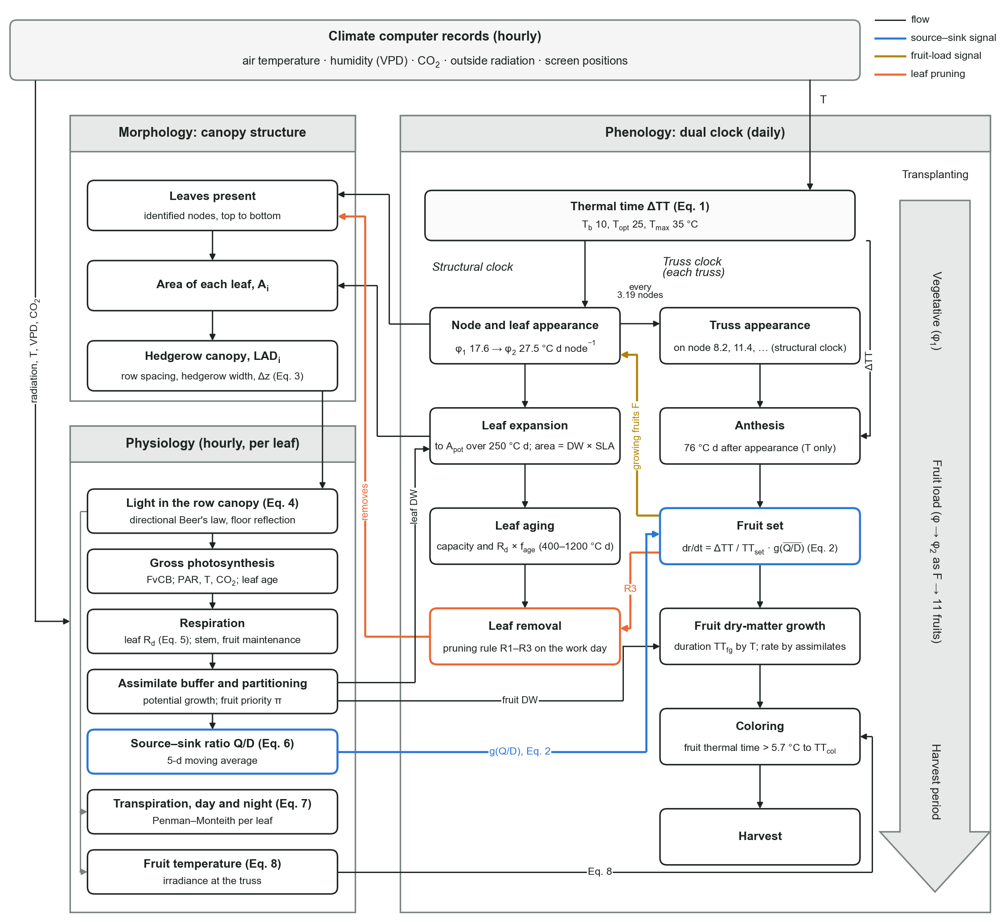

# Node-based tomato FSPM with dual-clock phenology and rule-based leaf pruning

[](https://doi.org/10.5281/zenodo.24128721)

Model code and analysis scripts for the manuscript

> Kang, J.H., Bae, S., Moon, T., Kim, D. *A node-based functional–structural tomato model with dual-clock phenology and rule-based leaf pruning for greenhouse decision support.* Submitted for publication.

The model follows a high-wire tomato plant node by node. Every node keeps its identity, so a leaf-pruning rule can remove particular leaves, and the model works out what that does to light, carbon gain, transpiration, fruit set and ripening. A season of 99 days with hourly photosynthesis, respiration and transpiration for every leaf runs in about half a second.

- **Structural clock.** Thermal time drives node and truss appearance. Leaf appearance slows as the number of growing fruits rises.
- **Reproductive clock.** On each truss, progress from anthesis to fruit set depends on thermal time and on the source–sink ratio. Coloring depends on fruit temperature.
- **Light.** A directional Beer's law model of periodic hedgerows gives the irradiance of each leaf, including light reflected by a white floor.
- **Leaf processes.** Photosynthesis (Farquhar–von Caemmerer–Berry), dark respiration and Penman–Monteith transpiration are computed hourly for each leaf.
- **Leaf pruning.** Rules read the simulated crop state and act on a weekly work schedule.

## Model overview

<p align="center">
  
</p>

**Processes of the model and their links** (Supplementary Fig. S2 of the paper). Left: the canopy structure and the hourly processes of each leaf. Right: the dual clock, that is, the structural clock (node and leaf appearance, expansion, aging and removal) and the clock of each truss (appearance, anthesis, fruit set, fruit dry-matter growth, coloring and harvest).

| Color | Link |
|---|---|
| 🟦 Blue | the source–sink ratio, which modulates progress to fruit set |
| 🟨 Gold | the number of growing fruits, which slows node appearance |
| 🟧 Orange | leaf pruning, which removes identified leaves |

Equation numbers in the figure refer to the paper. The table under [Model code](#model-code) lists the module behind each box.

## What is in this repository

| Path | Content |
|---|---|
| `src/fspm/` | The model (Python package) |
| `src/*.py` | Scripts that prepare the data, calibrate and evaluate the model, run the scenarios and draw the figures of the paper |
| `data_external/aihub/agg.py`, `agg_c.py` | Scripts that turn the AI-Hub label archives into the tables the evaluation reads |
| `data_processed/params_m2.json`, `data_processed/hg/params_hg.json` | Calibrated parameter sets of the two crops (Table 1 of the paper) |
| `examples/demo_synthetic.py` | A run with an invented climate, which needs no measured data |
| `docs/model_processes.png` | The process diagram shown above |

Measured data are **not** included; see [Data](#data). Without them, the demo and the model itself run, but the scripts in `src/` that reproduce the paper do not.

## Installation

Python 3.10 or later.

```bash
git clone https://github.com/vlfrmfla/tomato_dual-clock_fspm_model.git
cd tomato_dual-clock_fspm_model
pip install -r requirements.txt
```

## Quick start

```bash
python examples/demo_synthetic.py
```

The demo builds an hourly climate from simple functions, runs one autumn–winter crop with three pruning rules and prints the state of the crop on the last day. The climate is invented, so the numbers are not results of the paper.

Calling the model directly:

```python
import sys
sys.path.insert(0, "src")
from fspm import Params, simulate, truss_table
from fspm import management as M

p = Params()                                   # defaults; see src/fspm/params.py
rule = M.TrussLinked(tt_after=235.0)           # leaf-pruning rule R3
daily, plant = simulate(climate_daily, p, rule, "2023-10-05", "2024-01-11",
                        hourly=climate_hourly, leaf_dw0=10.0, stem_dw0=4.0)

daily[["nodes", "leaves_present", "LAI", "fruit_dw", "et_g", "qd"]]   # one row per day, per plant
truss_table(plant)                             # dates of appearance, anthesis, set and harvest per truss
```

### Climate input

`climate_daily`: one row per day, indexed by date. It must start at the transplanting date (`Params.transplant`).

| Column | Unit | Required | Use |
|---|---|---|---|
| `Tmean` | °C | yes | thermal time |
| `Rg_out_MJ` | MJ m⁻² d⁻¹ | no | outside global radiation; only read by the radiation-driven control of the reproductive clock |

`climate_hourly`: 24 rows per day, indexed by the start of each hour, without gaps in the simulated period.

| Column | Unit | Required | Use |
|---|---|---|---|
| `T` | °C | yes | air temperature in the greenhouse |
| `Rg_out` | W m⁻² | yes | outside global radiation |
| `VPD` | kPa | yes | vapor pressure deficit |
| `CO2` | µmol mol⁻¹ | no | otherwise `Params.Ca` |
| `curt1`, `curt2`, `curt3` | % closed | no | shade screen and two energy screens |
| `sun_elev`, `sun_az`, `kd`, `tau_glass` | °, °, –, – | no | solar position, diffuse fraction and transmittance of the glass roof, from `fspm.greenhouse.roof_glass_transmittance` |

If radiation was measured inside the greenhouse, pass it as `Rg_out` and set the transmittances to 1, as `src/run_hoenggye.py` does.

### Leaf-pruning rules

| Rule | Class in `fspm.management` | Decision |
|---|---|---|
| – | `NoPruning()` | keeps all leaves |
| R0 | `ObservedTrajectory(dates, leaves)` | follows an observed number of leaves present |
| R1 | `KeepN(n, trigger)` | keeps a target number of leaves, constant or a function of the 7-day mean temperature (`KeepN.jeong2026`) |
| R2 | `LightThreshold(wli_min)` | removes the lowest leaves whose weekly light integral is below a threshold |
| R3 | `TrussLinked(tt_after)` | removes all leaves up to the highest truss whose fruits set at least `tt_after` °C d ago |

The work schedule is part of the parameters: `prune_weekday` (0 = Monday), `prune_max_per_event` and `prune_min_batch` (6 gives the batch pruning of the paper).

## Model code

| Module | Content | Paper |
|---|---|---|
| `plant.py` | nodes, leaves, trusses and their stages | Section 2.3 |
| `phenology.py` | thermal time, structural clock, reproductive clock | Sections 2.3.1–2.3.2, Eqs. 1–2 |
| `light_row.py` | light in the hedgerow canopy, floor reflection | Section 2.3.3, Eqs. 3–4 |
| `source.py` | inside radiation, leaf photosynthesis, dark respiration, transpiration | Sections 2.3.4–2.3.5, Eqs. 5 and 7 |
| `carbon.py` | organ demand, source–sink ratio, partitioning, assimilate buffer | Section 2.3.4, Eq. 6 |
| `fruit.py` | fruit irradiance, fruit temperature, coloring | Section 2.3.5, Eq. 8 |
| `management.py` | pruning rules and work schedule | Section 2.3.6, Table 2 |
| `greenhouse.py` | solar position, diffuse fraction, transmittance of the glass roof | Supplementary Section S5 |
| `params.py` | all parameters with their defaults | Table 1 |
| `model.py` | daily loop (`simulate`), truss table | Section 2.3 |

## Reproducing the paper

These steps need the data. Run the scripts from the repository root, for example `python src/calibrate_m2.py`. Each script states its inputs and outputs in its header. Tables are written to `data_processed/`, figures to `figures/`.

| Step | Script | Result |
|---|---|---|
| Haman inputs | `build_obs.py`, `build_loadcell.py`, `truss_events.py` | hourly and daily climate, crop surveys, daily load-cell transpiration, event dates per truss |
| Calibration | `calibrate_m2.py`, `test_phyllo.py` | `params_m2.json`; reproductive-clock models A and B; phyllochron models (Tables 1, 3 and 5) |
| Evaluation | `run_m1.py`, `run_m2.py`, `eval_et_split.py`, `eval_night_et.py` | structure and pruning rules (Table 4a), growth and transpiration (Table 3) |
| Fruit-set timing | `cv_c1.py`, `cv_radiation.py`, `eval_fruitset.py` | leave-one-plant-out cross-validation, radiation-driven control, scoring against observation intervals (Table 5, Section S8) |
| Identifiability | `sens_rd_grid.py`, `uncertainty.py` | leaf dark respiration (Fig. S1), equally good parameter sets (Section S6) |
| Second greenhouse | `build_hoenggye.py`, `calibrate_hoenggye.py` (`--rules` recalibrates each pruning rule), `run_hoenggye.py` | Section 3.6, Table 4b |
| Scenarios | `scenario_season.py`, `scenario_ripening.py` | leaf-number scenarios in three crops (Table 6, Fig. 7) |
| Sensitivity | `sens_source.py`, `sens_buffer.py`, `sens_qd_ema.py`, `night_share.py` | Sections S7, S9 and S10; moving average of the source–sink ratio (Section 2.3.2) |
| AI-Hub | `data_external/aihub/agg.py`, `agg_c.py`, then `external_aihub.py`, `qc_aihub.py` | truss intervals and radiation effect in two more greenhouses (Section 3.5, Section S3) |
| Figures | `paper_figs.py` (all), `paper_figs.py 7` (one) | Figs. 2–7, S1 and S2; Fig. 1 was drawn by hand |

`fig_schematic.py`, `fig_light.py`, `fig_external.py` and `sens_rd.py` are earlier versions of figures and analyses. They are kept for the record and are not used for the paper.

## Data

- **Greenhouse data** (climate records, crop surveys and load-cell records of the Haman and Hoenggye greenhouses) are not included at this stage. We plan to add them after the paper is published.
- **AI-Hub dataset** 'Intelligent smart farm integrated data (tomato)' cannot be redistributed. It is available from [AI-Hub](https://www.aihub.or.kr) after registration, under the provider's terms of use. Put the label archives (`TL_*.zip`) and `TS_Timeseries.zip` in `data_external/aihub/` and run the two aggregation scripts.

The `.gitignore` keeps raw and derived data files out of the repository.

## Notes

- Comments and docstrings in `src/` are in Korean, and some are working notes from model development. Parameter sources are marked `[obs]` (estimated from our data), `[lit]` (literature) and `[cal]` (calibrated).
- `Params` defaults describe the Haman crop before the final calibration. The calibrated values are in the two JSON files and are applied as in `examples/demo_synthetic.py`.
- A generative AI coding assistant helped write and debug the code under the direction of the authors, as declared in the paper.

## Citation

Please cite the paper above; its full reference will be added here once it is published. To cite the code:

> Kang, J.H., Bae, S., Moon, T., Kim, D., 2026. Node-based tomato FSPM with dual-clock phenology and rule-based leaf pruning, version 1.0.0. Zenodo. https://doi.org/10.5281/zenodo.24128721

This DOI identifies version 1.0.0, the code used for the manuscript. https://doi.org/10.5281/zenodo.24128720 always resolves to the latest version.

## License

MIT License; see `LICENSE`. The license covers the code and the parameter files in this repository, not the AI-Hub dataset.
